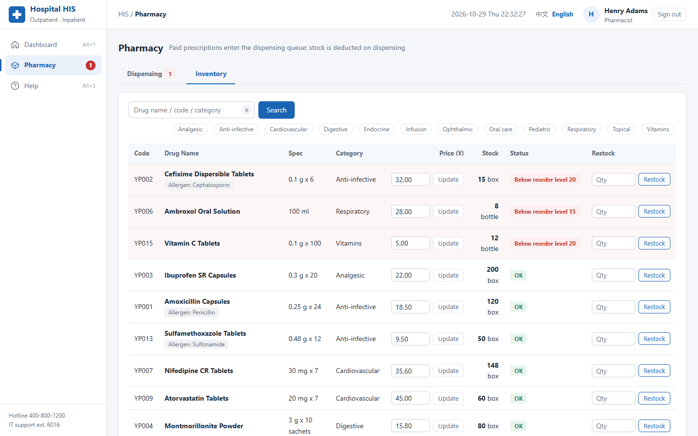
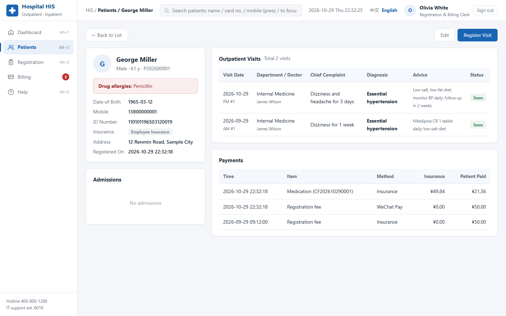
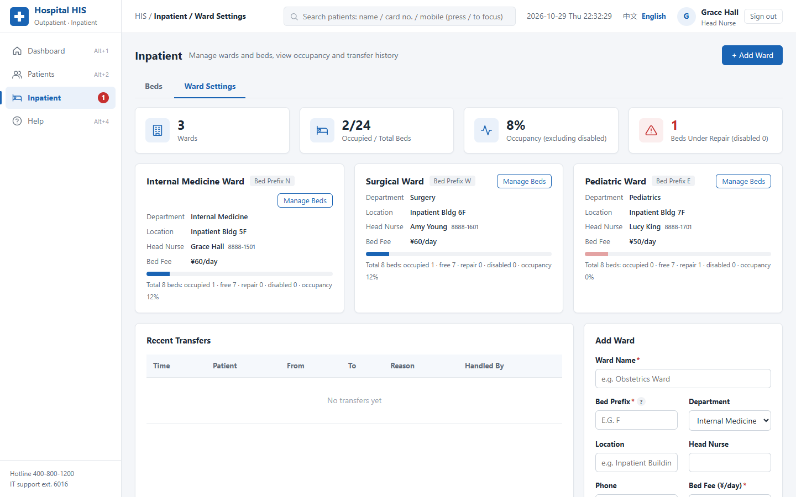
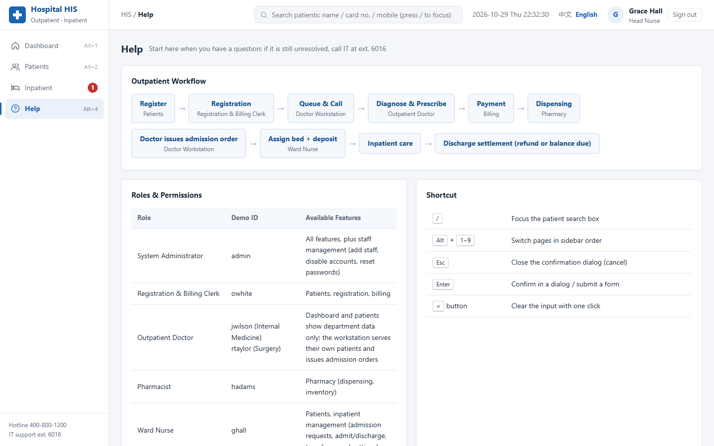
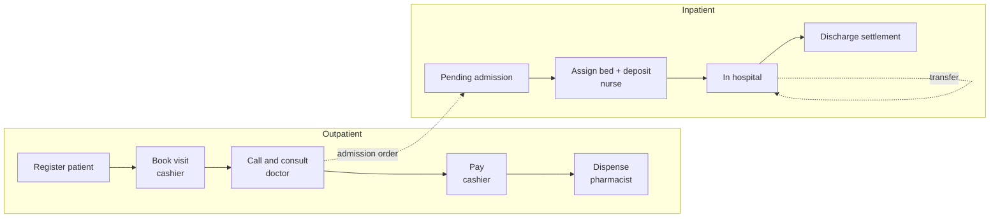
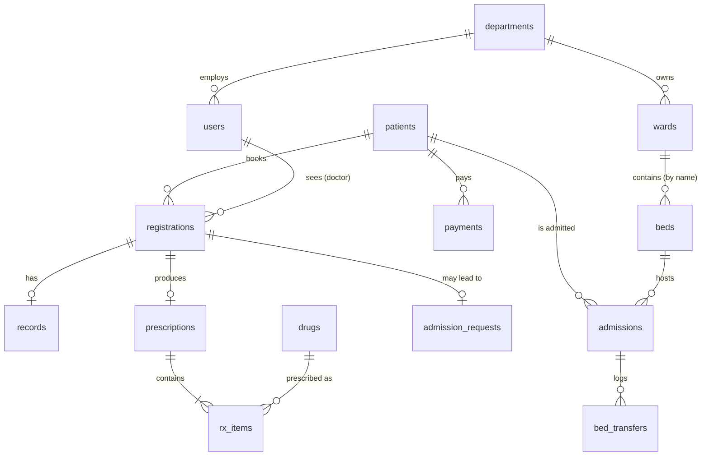

# Hospital Information System (HIS)

**English** | [简体中文](README.zh-CN.md)

[](https://github.com/Brian61-liu/hospital-his/actions/workflows/tests.yml)


A web-based hospital information system built with **Flask + SQLite + HTML/CSS/JavaScript**. It covers the full outpatient workflow (registration → consultation → billing → pharmacy) and the inpatient workflow (admission order → bed assignment → transfer → discharge settlement). Each of the five hospital roles gets its own set of pages.

The interface is **bilingual (English / 简体中文)**, and each language has its own demo dataset. The business rules a real hospital depends on are enforced on the server: allergy checks, stock checks, slot quotas, insurance co-payment and segmented bed-fee billing. An end-to-end test suite covers them.


## Highlights

* **Two complete clinical workflows** with explicit state machines for registrations, prescriptions, admission requests, admissions and beds.
* **Safety checks at the point of care:** prescribing a drug whose allergen matches the patient's allergy history is blocked until the doctor explicitly confirms the risk. Quantities are validated against live stock, and dispensing is all-or-nothing.
* **Realistic billing:** insurance co-payment by insurance type, refunds through the original payment method (including the insurance share), and discharge settlement. Bed fees are split at each bed transfer.
* **Role-based access control** for 5 roles, through a single decorator. Doctors see only their own department and patients, and deactivated accounts are signed out on their next request.
* **Bilingual by design:** Chinese source strings are translated at render time, so the business logic and the stored status values are identical in both languages.
* **15 end-to-end tests** run through the Flask test client on every push (GitHub Actions, Python 3.9 and 3.12).
* About 1,500 lines of Flask (44 routes), 20 Jinja2 templates and 13 SQLite tables.

## Contents

1. [Features](#features)
2. [Screenshots](#screenshots)
3. [Getting started](#getting-started)
4. [Workflows and state machines](#workflows-and-state-machines)
5. [Business rules](#business-rules)
6. [Data model](#data-model)
7. [Security](#security)
8. [Internationalisation](#internationalisation)
9. [Testing](#testing)
10. [Design principles](#design-principles)
11. [Project structure](#project-structure)
12. [Limitations](#limitations)

## Features

| Module | What it does |
|---|---|
| Sign-in and permissions | Role-based menus, remembered staff ID, account deactivation, password change |
| Dashboard | Role-specific statistics and to-do badges. Doctors see only their own department |
| Patients | Create, edit and search patients. View visit history, payments and admissions |
| Registration | Booking up to 7 days ahead, live slot counts, printable registration slip, cancellation |
| Doctor workstation | Queue calling, electronic medical records, prescriptions with **allergy and stock checks**, draft saving, “step away”, admission orders, printable records |
| Billing | Insurance settlement (70 % / 50 % coverage), refunds for prescriptions not yet dispensed, daily transactions grouped by payment method |
| Pharmacy | Dispensing with automatic stock deduction, restocking, price changes, new drugs, low-stock alerts |
| Inpatient | Pending admissions, bed board, deposits, bed transfers, discharge settlement with bed fees split by transfer |
| Ward settings | Create and delete wards, add beds, set bed status and fees, occupancy statistics, transfer log |
| Staff | Add staff, disable or enable accounts, reset passwords (admin only) |
| Help | Workflow diagram, role permissions, keyboard shortcuts, FAQ |

## Screenshots

| Sign in | Consultation | Registration |
|---|---|---|
|  |  |  |

| Billing | Pharmacy inventory | Patient record |
|---|---|---|
|  |  |  |

| Inpatient bed board | Ward settings | Help centre |
|---|---|---|
|  |  |  |

## Getting started

Requirements: Python 3.9+

```bash
git clone https://github.com/Brian61-liu/hospital-his.git
cd hospital-his
pip install -r requirements.txt
python app.py
```

Open <http://127.0.0.1:5000/> in your browser.

- On the first run, `hospital.db` (Chinese) and `hospital_en.db` (English) are created automatically with demo data.
- To reset the demo data, run `python database.py`.
- Debug mode is off by default. Set `FLASK_DEBUG=1` to enable it during development.
- For deployment, set the `SECRET_KEY` environment variable to a random value.

### Demo accounts

All demo accounts use the password **`123456`**. Switching the language signs you out, because each language has its own staff and patients.

| Role | English UI | Chinese UI | Main pages |
|---|---|---|---|
| System administrator | `admin` | `admin` | All pages + staff management |
| Registration and billing clerk | `owhite` | `shoufei` | Patients, registration, billing |
| Doctor (Internal Medicine) | `jwilson` | `zhangwei` | Dashboard, patients (own department), doctor workstation |
| Doctor (Surgery) | `rtaylor` | `zhaolei` | Same as above |
| Pharmacist | `hadams` | `yaofang` | Pharmacy |
| Ward nurse | `ghall` | `hushi` | Patients, inpatient management, ward settings |

## Workflows and state machines



Every record moves through a fixed set of states. Each route checks the current state before it changes anything, so repeated clicks and stale pages cannot charge, dispense or discharge twice.

| Entity | States |
|---|---|
| Registration | `Waiting → In consultation → Seen`. A waiting registration can also go to `Cancelled` (refund) or to `Expired` (automatically, once its date has passed). “Step away” returns a patient from `In consultation` to `Waiting` |
| Prescription | `Unpaid → Paid → Dispensed`, or `Paid → Refunded` |
| Admission request | `Pending → Admitted`, or `Pending → Withdrawn` |
| Admission | `In hospital → Discharged` |
| Bed | `Free ⇄ Occupied` (maintained by admission, transfer and discharge). `Repair` and `Disabled` can be set manually, but only on beds with no patient |

## Business rules

**Registration**
- Visits can be booked from today up to 7 days ahead. Each doctor has **20 slots per session** (morning or afternoon).
- The same patient cannot book the same doctor twice in one session. Morning booking for today closes at noon.
- Queue numbers count cancelled registrations as well, so numbers are never reused. Only waiting registrations can be cancelled, and the fee is refunded.
- Waiting registrations from past days are marked *Expired* automatically, once per day per database.

**Doctor workstation**
- Doctors can only see patients registered to them. “Call next” is refused while another patient is still in consultation.
- A diagnosis is required to finish a visit. Quantities must be positive integers no greater than current stock, and the same drug cannot appear on two lines.
- **Allergy check:** each drug carries an allergen keyword (for example *penicillin*, *cephalosporin*, *sulfonamide* or *quinolone*). If it appears in the patient's allergy history, the prescription is rejected until the doctor ticks *“allergy risk assessed”*.
- Drafts (the record plus the prescription as JSON) can be saved and resumed. Finishing the visit locks the record and sends the prescription to billing.

**Billing**
- Insurance pays a share of the prescription total: **70 %** for employee insurance, **50 %** for resident insurance and **0 %** for self-pay. Self-pay patients cannot use insurance settlement.
- Refunds are only possible for prescriptions that are paid but not yet dispensed. They go back through the original payment method, and the insurance share is reversed as well.
- Each prescription item stores the price at the time of prescribing, so later price changes do not affect prescriptions already issued.

**Pharmacy**
- Dispensing is **atomic**: if any item is short, nothing is deducted and the missing quantities are listed.
- Drugs below their reorder level are sorted to the top of the inventory and counted on the dashboard. Restocking accepts 1–10,000 units, and drug codes must match `YP` followed by digits.

**Inpatient**
- A patient can have at most one pending admission request and at most one active admission.
- The minimum deposit is ¥500. Only free beds can be assigned.
- **Bill at discharge:**

  ```
  days       = max(today − admission date, 1)
  bed fee    = Σ (days in each bed before a transfer × that bed's daily fee)
             + remaining days × current bed's daily fee
  nursing    = days × ¥25
  balance    = deposit − (bed fee + nursing)  → refunded if ≥ 0, otherwise collected
  ```

- A ward can only be deleted once it has no beds. A bed with admission or transfer history cannot be deleted and must be disabled instead, which keeps records traceable. Occupancy is calculated without disabled beds.

## Data model



All amounts are recorded in `payments`. A negative amount is a refund, and `insurance_pay` stores the insurance share separately. Business numbers follow the pattern `<prefix><yyyymmdd><seq>`, for example `GH202610290001` for a registration. The prefixes are `GH` registration, `CF` prescription, `SF` payment, `ZZ` admission request and `ZY` admission. Foreign keys are enforced with `PRAGMA foreign_keys = ON`. Older databases are migrated in place, with missing tables and columns added on start-up.

## Security

| Concern | Implementation |
|---|---|
| Passwords | Hashed with Werkzeug (`scrypt`). Plain-text passwords are never stored |
| Authorisation | The `@login_required(*roles)` decorator checks the session, the account status and the role on every request. Admins can access everything. Doctors are additionally limited to their own patients and department |
| Deactivated accounts | Checked on every request, so a disabled user is signed out immediately rather than when the session expires |
| SQL injection | Every query is parameterised. Dynamic `IN (...)` lists are built from `?` placeholders |
| Open redirects | `next` and `back` parameters must be site-relative paths. `//host`, absolute URLs and back-slashes are rejected |
| Configuration | `SECRET_KEY` is read from the environment, and debug mode is off unless `FLASK_DEBUG=1` |

## Internationalisation

- Interface text is written in Chinese and wrapped in `_()` in Python and templates, or `t()` in JavaScript.
- `translations_en.py` maps about 450 Chinese strings to English. Numbered placeholders (`{0}`, `{1}`) let the English text use its own word order.
- Status values such as *Waiting* or *Paid* are stored in Chinese in both databases and translated only for display, so the business logic is shared.
- The language comes from the `lang` cookie, which the switch sets. Without a cookie, the browser's `Accept-Language` header decides. Each language uses its own database, so demo data never mixes.

## Testing

```bash
pip install -r requirements-dev.txt
pytest -q
```

The suite builds fresh demo databases in a temporary folder for every test and drives the app through the Flask test client:

| Area | What is verified |
|---|---|
| Access control | Wrong passwords are rejected, pages require login, roles are restricted, disabled accounts are signed out, open redirects are blocked |
| Rendering | All 12 main pages render for the admin in both languages |
| Outpatient | Registration fee and duplicate-booking check → allergy block, then explicit confirmation → 70 % insurance split → dispensing deducts stock |
| Billing | Self-pay patients cannot use insurance. Refunds reverse both the personal and the insurance share |
| Stock and quota | Over-stock prescriptions are rejected, dispensing with a shortage changes nothing, full slots block registration |
| Inpatient | Duplicate admission is blocked, the minimum deposit is enforced, and a transfer after 6 of 10 days is billed as 6 × 60 + 4 × 50 + 10 × 25 = 810 with the correct refund |

## Design principles

| Principle | Examples in this system |
|---|---|
| Visibility of system status | Badges for pending tasks, visit progress bar, live slot counts and amounts |
| Match with the real world | Pages follow real hospital roles. Doctors issue admission orders and nurses assign beds |
| User control | Registration cancellation, refunds, withdrawable admission requests, confirmation dialogs |
| Consistency | Shared layout, colours, buttons and status labels across all pages |
| Error prevention | Allergy alerts, duplicate-registration checks, slot and stock validation |
| Recognition over recall | Remembered staff ID, recent patients, visit history, prescription drafts |
| Flexibility and efficiency | Keyboard shortcuts (`/`, `Alt+number`), one-click queue calling, common diagnoses and dosages |
| Aesthetic and minimalist design | Hospital-blue theme, card layout, only the content each role needs |
| Error recovery | Inline error messages that keep user input, friendly error pages |
| Help and documentation | Help centre with workflow and FAQ, field hints |

## Project structure

```
hospital-his/
├── app.py                 # Flask routes, permissions and page logic (44 routes)
├── database.py            # Schema, demo data (zh / en) and reusable business functions
├── i18n.py                # Language selection and translation helpers
├── translations_en.py     # English translations, keyed by the original Chinese text
├── templates/             # 20 Jinja2 templates, all extending base.html
├── static/
│   ├── css/style.css      # Shared styles
│   └── js/main.js         # Clock, shortcuts, confirmation dialogs, notifications
├── tests/                 # End-to-end pytest suite
├── docs/screenshots/      # README screenshots (en / zh)
├── requirements.txt
└── requirements-dev.txt
```

## Limitations

This is a demonstration system. Before any real use it would need:

- **CSRF protection** on the POST forms, for example with Flask-WTF.
- A server database such as PostgreSQL in place of SQLite, plus audit logging for every change to medical and financial data.
- A rule against keeping the default password `123456`, and a check for password strength.
- Integration with real insurance, laboratory and imaging systems. The ratios here are simplified flat rates.

All patients, staff, phone numbers, ID numbers and addresses in the demo data are fictional. The ID numbers deliberately fail the checksum.

## License

[MIT](LICENSE)
