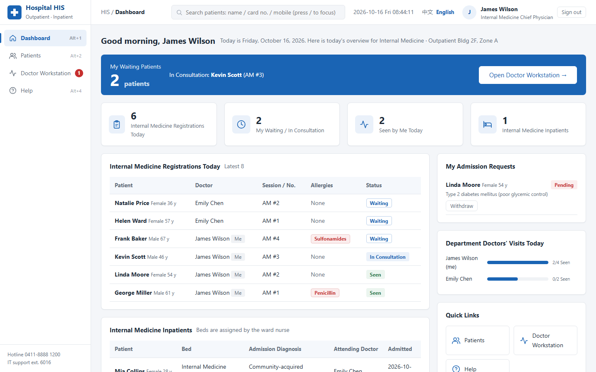
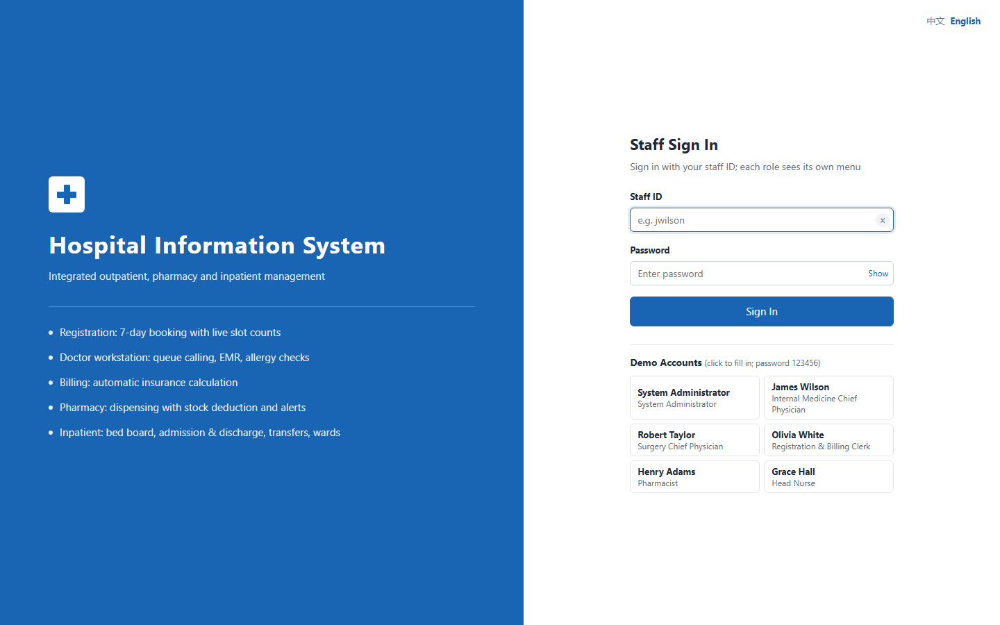
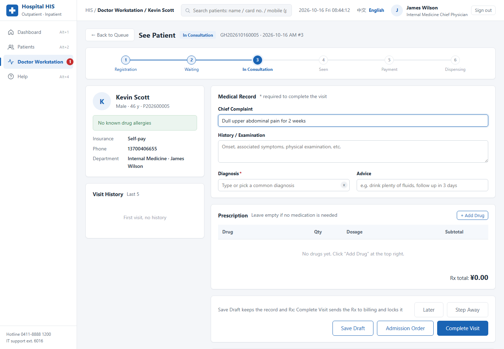
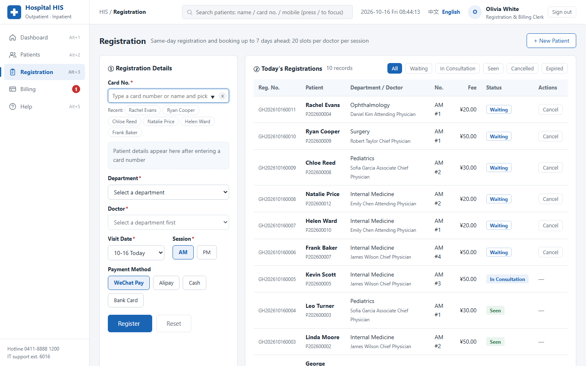
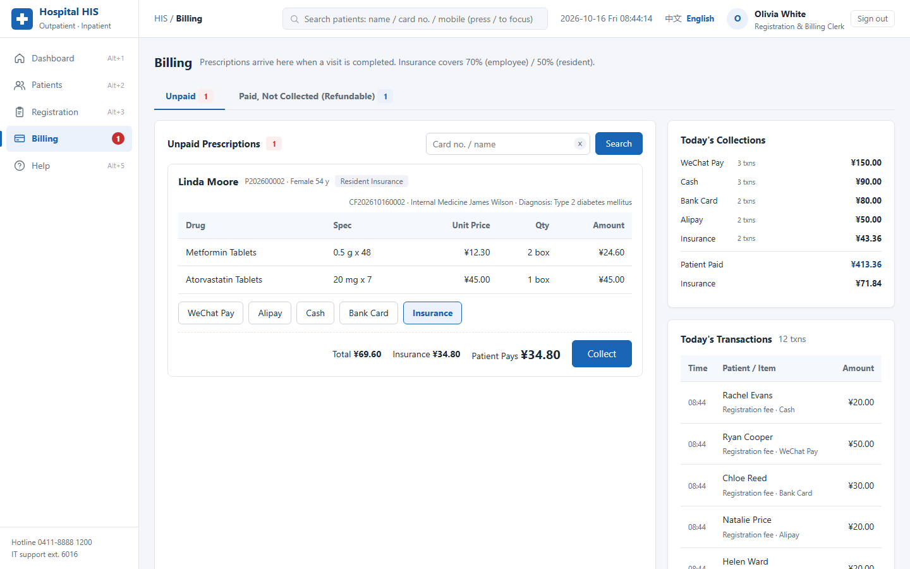
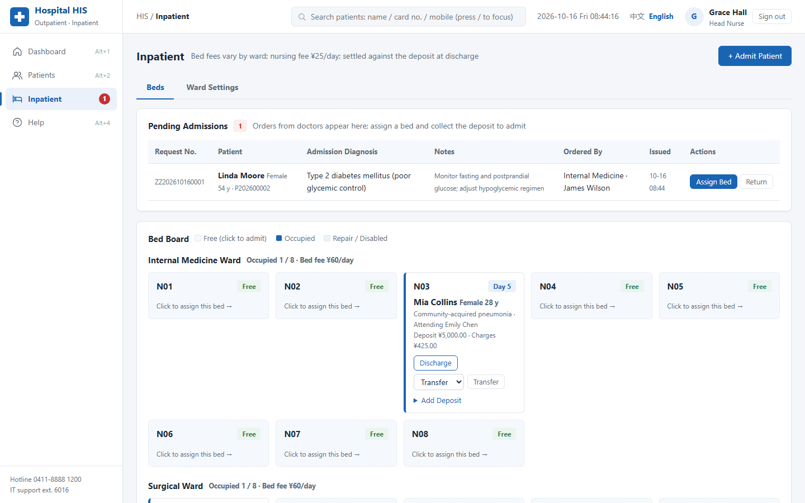

# Hospital Information System (HIS)

**English** | [简体中文](README.zh-CN.md)

A web-based hospital information system built with **Flask + SQLite + HTML/CSS/JavaScript**.
It covers the full outpatient workflow (registration → consultation → billing → pharmacy) and the
inpatient workflow (admission request → bed assignment → transfer → discharge settlement), with
role-based pages for five types of hospital staff.

The interface is **bilingual (English / 简体中文)**. Use the language switch in the top bar or on the
sign-in page; each language comes with its own set of demo data.



## Features

| Module | What it does |
|---|---|
| Sign-in & permissions | Role-based menus, remembered staff ID, account deactivation, password change |
| Dashboard | Role-specific statistics; doctors only see data from their own department |
| Patients | Create / edit / search patients, view visit history, payments and admissions |
| Registration | Booking up to 7 days ahead, live slot counts, printable registration slip, cancellation |
| Doctor workstation | Queue calling, electronic medical records, prescriptions with **allergy and stock checks**, draft saving, admission orders, printable records |
| Billing | Insurance settlement (70% / 50% coverage), refunds for undispensed prescriptions, daily transactions |
| Pharmacy | Dispensing with automatic stock deduction, restocking, price changes, low-stock alerts |
| Inpatient | Pending admissions, bed board, deposits, bed transfers, discharge settlement (bed fees split by transfer), ward & bed settings |
| Staff | Add staff, disable / enable accounts, reset passwords (admin only) |
| Help | Workflow diagram, role permissions, keyboard shortcuts, FAQ |
| Internationalization | English / Chinese UI with a separate demo dataset per language |

### Workflow

- **Outpatient:** register patient → book a visit → consultation & prescription → payment → dispensing
- **Inpatient:** doctor issues an admission order → nurse assigns a bed and collects the deposit → (bed transfer) → discharge settlement

## Screenshots

| Sign in | Consultation | Registration |
|---|---|---|
|  |  |  |

| Billing | Inpatient bed board |
|---|---|
|  |  |

## Getting started

Requirements: Python 3.8+

```bash
git clone https://github.com/Brian61-liu/hospital-his.git
cd hospital-his
pip install -r requirements.txt
python app.py
```

Open <http://127.0.0.1:5000/> in your browser.

- On the first run, `hospital.db` (Chinese) and `hospital_en.db` (English) are created automatically with demo data.
- To reset the demo data, run `python database.py`.
- For deployment, set the `SECRET_KEY` environment variable to a random value.

### Demo accounts

All demo accounts use the password **`123456`**. Switching the language signs you out, because each
language has its own staff and patients.

| Role | English UI | Chinese UI | Main pages |
|---|---|---|---|
| System administrator | `admin` | `admin` | All pages + staff management |
| Registration & billing clerk | `owhite` | `shoufei` | Patients, registration, billing |
| Doctor (Internal Medicine) | `jwilson` | `zhangwei` | Dashboard, patients (own department), doctor workstation |
| Doctor (Surgery) | `rtaylor` | `zhaolei` | Same as above |
| Pharmacist | `hadams` | `yaofang` | Pharmacy |
| Ward nurse | `ghall` | `hushi` | Patients, inpatient management, ward settings |

## Project structure

```
hospital-his/
├── app.py              # Flask routes, permissions and page logic
├── database.py         # Schema, demo data (zh / en) and business functions
├── i18n.py             # Language selection and translation helpers
├── translations_en.py  # English translations, keyed by the original Chinese text
├── requirements.txt
├── static/
│   ├── css/style.css   # Shared styles
│   └── js/main.js      # Clock, shortcuts, confirmation dialogs, notifications
├── templates/          # Jinja2 templates, all extending base.html
└── docs/screenshots/   # Screenshots used in the README (en / zh)
```

### How the translation works

- Interface text is written in Chinese and wrapped in `_()` in Python and templates, or `t()` in JavaScript.
- `translations_en.py` maps each Chinese string to English; numbered placeholders (`{0}`, `{1}`) let the English text use its own word order.
- Status values such as *Waiting* or *Paid* are stored in Chinese in the database and translated only when displayed, so the business logic is the same for both languages.
- The language comes from the `lang` cookie (set by the switch). If there is no cookie, the browser's `Accept-Language` header decides.

## Design principles

| Principle | Examples in this system |
|---|---|
| Visibility of system status | Badges for pending tasks, visit progress bar, live slot counts and amounts |
| Match with the real world | Pages follow real hospital roles; doctors issue admission orders while nurses assign beds |
| User control | Registration cancellation, refunds, withdrawable admission requests, confirmation dialogs |
| Consistency | Shared layout, colors, buttons and status labels across all pages |
| Error prevention | Allergy alerts, duplicate-registration checks, slot and stock validation |
| Recognition over recall | Remembered staff ID, recent patients, visit history, prescription drafts |
| Flexibility and efficiency | Keyboard shortcuts (`/`, `Alt+number`), one-click queue calling, common options |
| Aesthetic and minimalist design | Hospital-blue theme, card layout, role-specific content only |
| Error recovery | Inline error messages that keep user input, friendly error pages |
| Help and documentation | Help center with workflow and FAQ, field hints |

## Tech stack

Python · Flask · Jinja2 · SQLite · HTML5 · CSS3 · JavaScript

> All patients, staff and records in the demo data are fictional.
