# 医院信息管理系统（HIS）

[English](README.md) | **简体中文**

[](https://github.com/Brian61-liu/hospital-his/actions/workflows/tests.yml)


基于 **Flask + SQLite + HTML/CSS/JavaScript** 的医院信息管理系统，覆盖完整的门诊流程（挂号 → 接诊 → 收费 → 发药）和住院流程（住院申请 → 安排床位 → 转床 → 出院结算），为五类医院岗位提供各自的功能页面。

界面支持 **中文 / English 双语**，两种语言各有一套独立的演示数据。真实医院依赖的业务规则都在服务端强制校验：过敏校验、库存校验、号源配额、医保分担、按转床分段计算床位费，并有一套端到端测试覆盖这些规则。

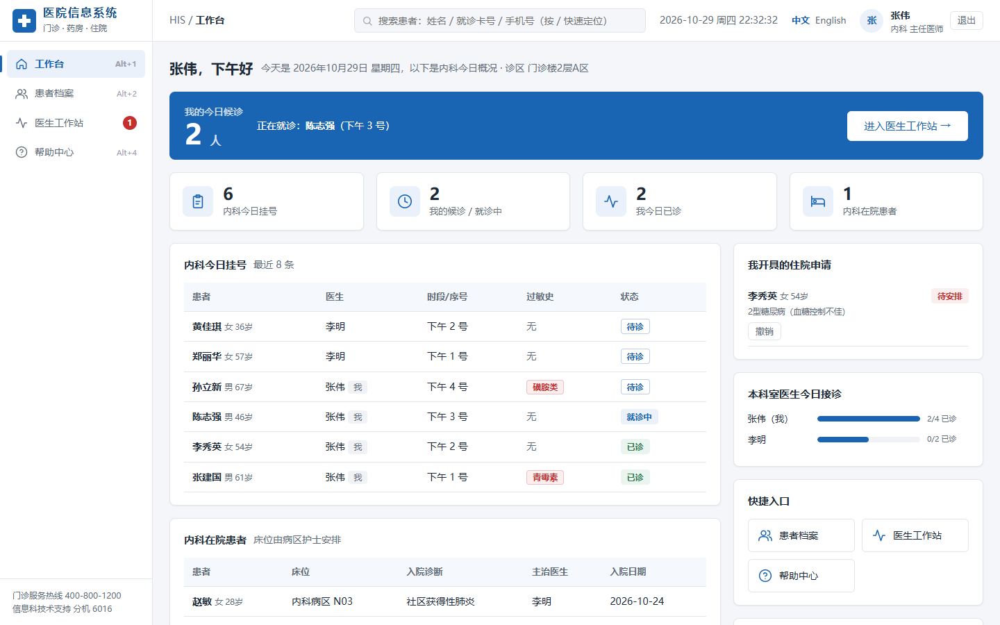

## 亮点

* **两条完整的临床业务流程**：挂号、处方、住院申请、住院记录和床位都有明确的状态流转。
* **在开方环节就做安全校验**：药品的过敏原与患者过敏史匹配时，医生必须明确确认风险后才能开方；数量按实时库存校验；发药要么全部成功、要么一样都不扣。
* **贴近实际的计费逻辑**：按医保类型分担费用；退费按原支付方式原路退回，医保部分一并冲回；出院结算时床位费按每次转床分段计算。
* **基于角色的权限控制**：5 类角色由一个装饰器统一控制；医生只能看到本科室和自己名下的患者；账号停用后，下一次请求就会被强制登出。
* **双语从设计上解决**：源码中的中文文案在渲染时才翻译，因此两种语言下的业务逻辑和数据库中的状态值完全一致。
* **15 个端到端测试**：通过 Flask 测试客户端运行，每次推送由 GitHub Actions 在 Python 3.9 和 3.12 上自动执行。
* 约 1500 行 Flask 代码（44 个路由），20 个 Jinja2 模板，13 张 SQLite 表。

## 目录

1. [功能](#功能)
2. [截图](#截图)
3. [快速开始](#快速开始)
4. [业务流程与状态流转](#业务流程与状态流转)
5. [业务规则](#业务规则)
6. [数据模型](#数据模型)
7. [安全](#安全)
8. [国际化](#国际化)
9. [测试](#测试)
10. [交互设计原则](#交互设计原则)
11. [项目结构](#项目结构)
12. [已知限制](#已知限制)

## 功能

| 模块 | 说明 |
|---|---|
| 登录与权限 | 按角色显示菜单、记住上次登录工号、账号停用、修改密码 |
| 工作台 | 按角色显示统计数据和待办角标；医生只看本科室数据 |
| 患者档案 | 建档、编辑、搜索；查看就诊记录、缴费记录和住院记录 |
| 门诊挂号 | 可预约今天起 7 天内的号，实时显示剩余号源，可打印挂号单，可退号 |
| 医生工作站 | 叫号、电子病历、处方（含**过敏和库存校验**）、暂存草稿、患者暂离、开具住院证、打印病历 |
| 收费结算 | 医保结算（统筹 70% / 50%）、已缴费未发药的处方可退费、当日流水按支付方式汇总 |
| 药房管理 | 发药时自动扣减库存、入库、调价、新增药品、低库存预警 |
| 住院管理 | 待入院申请、床位一览、补交押金、转床、出院结算（床位费按转床分段计算） |
| 病区设置 | 新建 / 撤销病区、增加床位、设置床位状态和床位费、床位使用率统计、转床记录 |
| 人员管理 | 新增员工、停用 / 启用账号、重置密码（仅管理员） |
| 帮助中心 | 业务流程图、各岗位权限、快捷键、常见问题 |

## 截图

| 登录 | 接诊 | 挂号 |
|---|---|---|
| 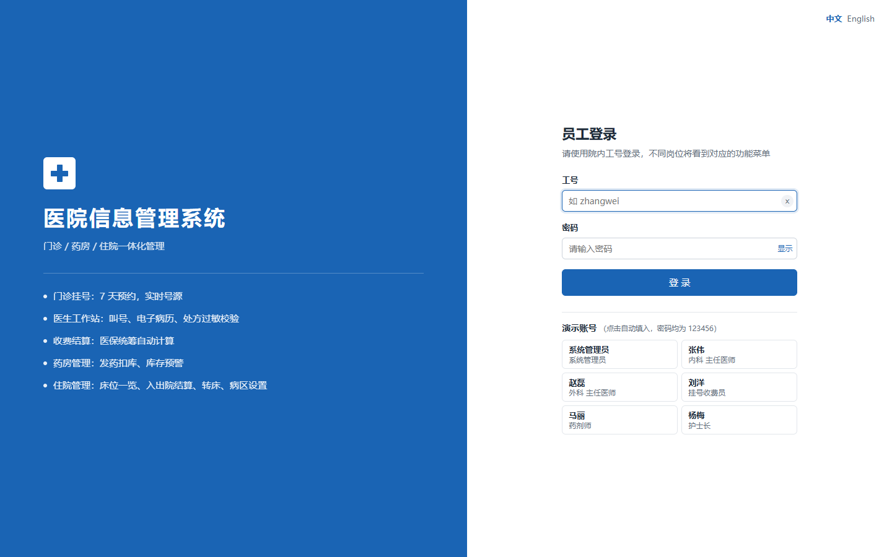 | 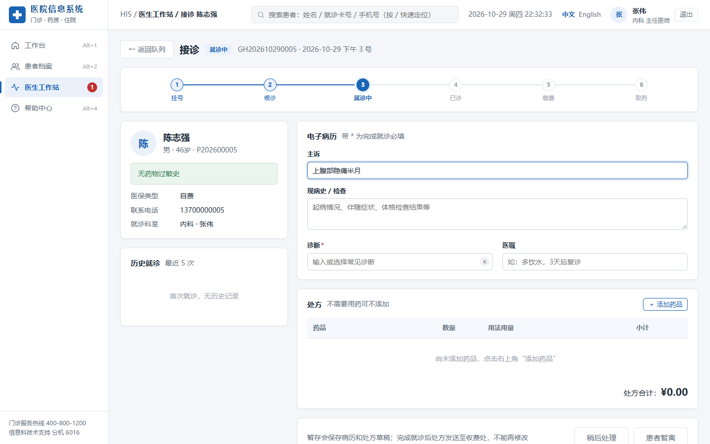 | 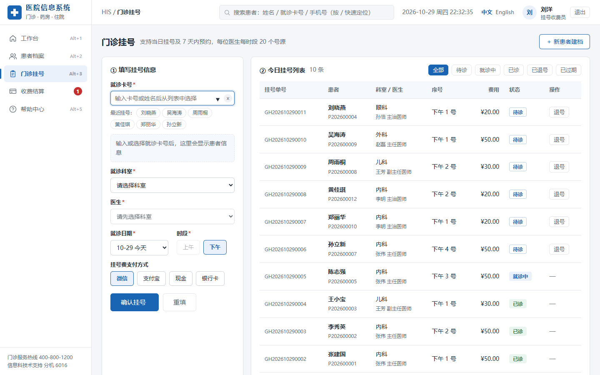 |

| 收费 | 药品库存 | 患者档案 |
|---|---|---|
| 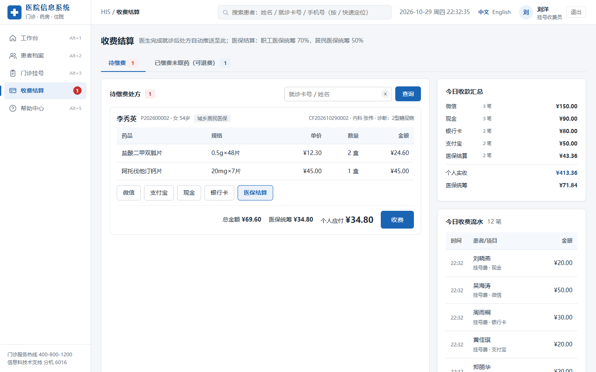 | 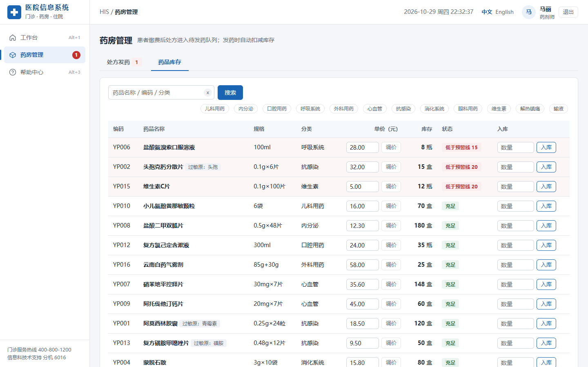 | 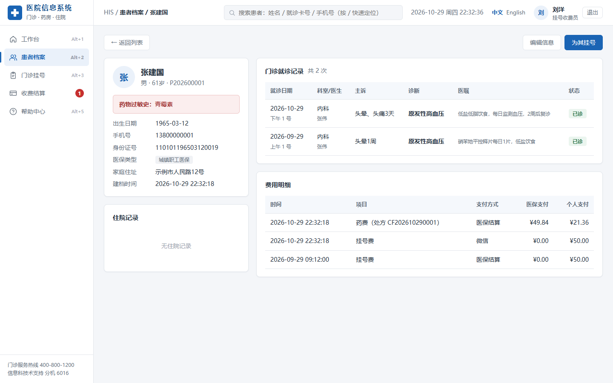 |

| 床位一览 | 病区设置 | 帮助中心 |
|---|---|---|
| 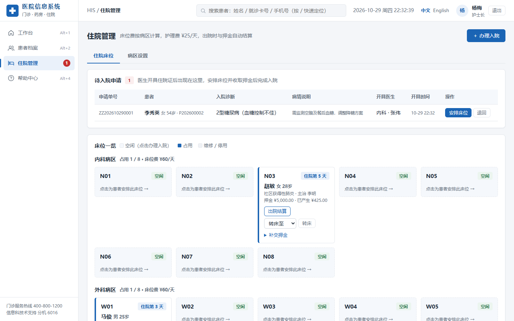 | 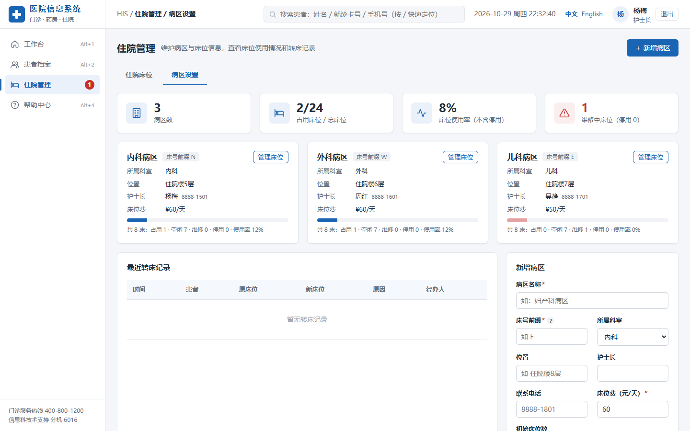 | 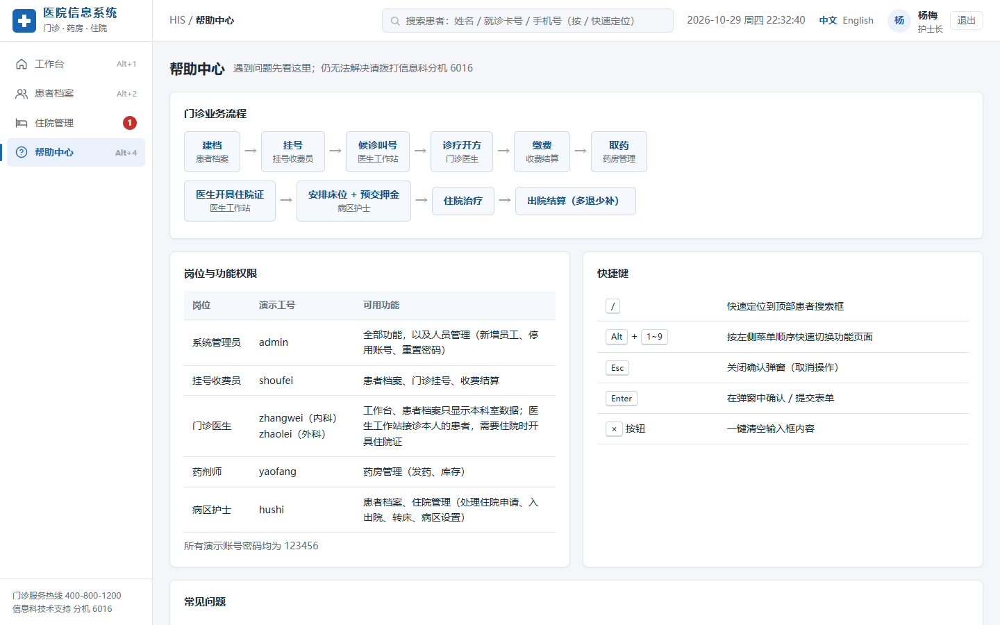 |

## 快速开始

环境要求：Python 3.9+

```bash
git clone https://github.com/Brian61-liu/hospital-his.git
cd hospital-his
pip install -r requirements.txt
python app.py
```

在浏览器中打开 <http://127.0.0.1:5000/>。

- 首次运行会自动创建 `hospital.db`（中文）和 `hospital_en.db`（英文），并写入演示数据。
- 运行 `python database.py` 可以重置演示数据。
- 调试模式默认关闭；开发时设置环境变量 `FLASK_DEBUG=1` 即可开启。
- 部署时请通过环境变量 `SECRET_KEY` 设置随机密钥。

### 演示账号

所有演示账号的密码都是 **`123456`**。由于两种语言的员工和患者数据互相独立，切换语言后需要重新登录。

| 角色 | 中文界面 | 英文界面 | 主要页面 |
|---|---|---|---|
| 系统管理员 | `admin` | `admin` | 全部页面 + 人员管理 |
| 挂号收费员 | `shoufei` | `owhite` | 患者档案、门诊挂号、收费结算 |
| 门诊医生（内科） | `zhangwei` | `jwilson` | 工作台、患者档案（本科室）、医生工作站 |
| 门诊医生（外科） | `zhaolei` | `rtaylor` | 同上 |
| 药剂师 | `yaofang` | `hadams` | 药房管理 |
| 病区护士 | `hushi` | `ghall` | 患者档案、住院管理、病区设置 |

## 业务流程与状态流转

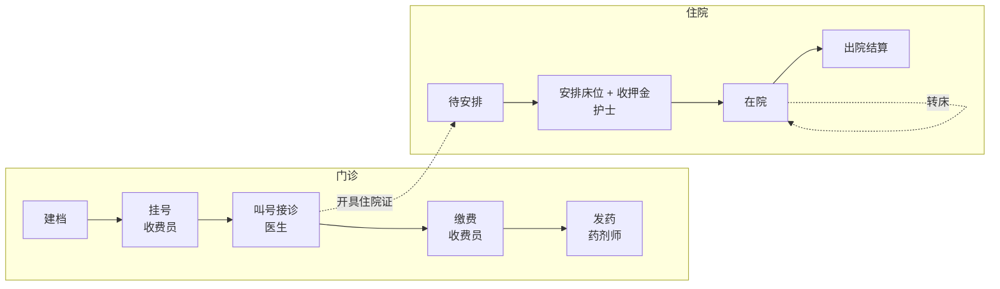

每条记录只能在固定的几个状态之间流转。每个路由在修改数据之前都会先检查当前状态，因此重复点击或停留在过期页面上，都不会导致重复收费、重复发药或重复出院。

| 对象 | 状态 |
|---|---|
| 挂号 | `待诊 → 就诊中 → 已诊`；待诊的挂号也可以 `已退号`（退回挂号费），或在就诊日期过后自动变为 `已过期`；“患者暂离”会把 `就诊中` 退回 `待诊` |
| 处方 | `待缴费 → 已缴费 → 已发药`，或 `已缴费 → 已退费` |
| 住院申请 | `待安排 → 已入院`，或 `待安排 → 已撤销` |
| 住院记录 | `在院 → 出院` |
| 床位 | `空闲 ⇄ 占用`（由入院、转床、出院自动维护）；`维修`、`停用` 可以手动设置，但只能对没有患者的床位操作 |

## 业务规则

**门诊挂号**
- 可预约今天起 7 天内的号；每位医生每个时段（上午 / 下午）**20 个号源**。
- 同一患者在同一时段不能重复挂同一位医生的号；当天中午 12 点以后不能再挂上午的号。
- 排队序号把已退号的记录也算在内，所以序号不会被重复使用；只有待诊的号可以退，挂号费原路退回。
- 就诊日期已过、仍处于待诊状态的挂号会自动标记为“已过期”，每个数据库每天只执行一次。

**医生工作站**
- 医生只能接诊挂在自己名下的患者；有患者正在就诊时，不能叫下一位。
- 完成就诊前必须填写诊断；药品数量必须是正整数且不超过当前库存；同一种药不能分两行开。
- **过敏校验**：每种药品都标有过敏原关键字（如青霉素、头孢、磺胺、喹诺酮）。如果它出现在患者的过敏史里，处方会被拦截，直到医生勾选“已评估过敏风险”。
- 病历和处方草稿（JSON）可以暂存、稍后继续；完成就诊后病历锁定，处方自动发送到收费处。

**收费结算**
- 医保统筹按处方总额的比例支付：**城镇职工医保 70%**、**城乡居民医保 50%**、**自费 0%**。自费患者不能选择医保结算。
- 只有已缴费且尚未发药的处方可以退费，按原支付方式原路退回，医保统筹部分一并冲回。
- 处方明细保存开方时的单价，因此之后调价不影响已开出的处方。

**药房**
- 发药是**原子操作**：只要有一种药库存不足，就一样都不扣，并列出缺药清单。
- 低于预警线的药品在库存列表中排在最前面，并计入工作台统计；入库数量限制在 1–10000；药品编码必须是 `YP` 加数字。

**住院**
- 同一患者最多只能有一条待安排的住院申请、一条在院记录。
- 押金最低 ¥500；只能安排空闲床位。
- **出院结算公式**：

  ```
  住院天数 = max(今天 − 入院日期, 1)
  床位费   = Σ（每次转床前在该床的天数 × 该床日费用）
           + 剩余天数 × 当前床位日费用
  护理费   = 住院天数 × ¥25
  结余     = 押金 − (床位费 + 护理费)  → 大于等于 0 时退还，小于 0 时补缴
  ```

- 病区只有在床位全部删除后才能撤销；有住院或转床记录的床位不能删除，只能设为“停用”，以便日后追溯；计算床位使用率时不计入停用床位。

## 数据模型

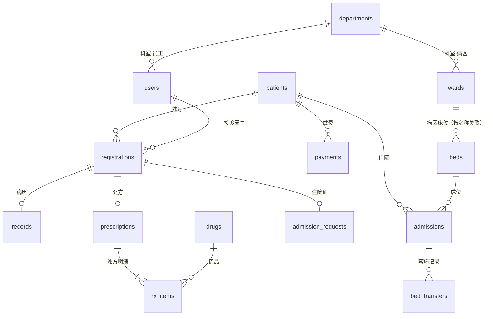

所有金额都记录在 `payments` 表中：负数表示退费，医保统筹部分单独记在 `insurance_pay`。业务单号格式为“前缀 + 年月日 + 序号”，例如挂号单 `GH202610290001`；前缀含义为：`GH` 挂号、`CF` 处方、`SF` 收费、`ZZ` 住院证、`ZY` 住院。通过 `PRAGMA foreign_keys = ON` 强制外键约束；旧版数据库启动时会自动补建缺失的表和字段。

## 安全

| 方面 | 实现方式 |
|---|---|
| 密码 | 使用 Werkzeug 哈希（`scrypt`），不保存明文 |
| 权限 | `@login_required(*roles)` 装饰器在每次请求时检查会话、账号状态和角色；管理员可访问全部页面；医生还被限制在本人患者和本科室数据范围内 |
| 停用账号 | 每次请求都会检查，账号被停用后立即登出，不必等会话过期 |
| SQL 注入 | 所有查询都使用参数化；动态 `IN (...)` 列表也由 `?` 占位符拼成 |
| 开放重定向 | `next` / `back` 参数只接受站内相对路径，拒绝 `//host`、绝对地址和反斜杠 |
| 配置 | `SECRET_KEY` 从环境变量读取；只有设置 `FLASK_DEBUG=1` 时才开启调试模式 |

## 国际化

- 界面文案用中文编写，Python 和模板中用 `_()` 包裹，JavaScript 中用 `t()` 包裹。
- `translations_en.py` 收录约 450 条中英对照；带编号的占位符（`{0}`、`{1}`）允许英文按自己的语序排列。
- “待诊”“已缴费”等状态值在两个数据库中都以中文保存，只在显示时翻译，因此业务逻辑是共用的。
- 语言由 `lang` cookie 决定（由切换按钮设置）；没有 cookie 时按浏览器的 `Accept-Language` 判断。每种语言使用独立的数据库，演示数据不会混在一起。

## 测试

```bash
pip install -r requirements-dev.txt
pytest -q
```

每个测试都会在临时目录中生成全新的演示数据库，并通过 Flask 测试客户端驱动应用：

| 范围 | 验证内容 |
|---|---|
| 权限 | 错误密码被拒绝、页面需要登录、角色越权被拦截、停用账号被强制登出、拦截开放重定向 |
| 页面渲染 | 管理员在两种语言下都能正常打开全部 12 个主要页面 |
| 门诊 | 挂号收费与重复挂号拦截 → 过敏拦截后需确认才能开方 → 医保 70% 分担 → 发药扣减库存 |
| 收费 | 自费患者不能医保结算；退费同时冲回个人支付和医保支付部分 |
| 库存与号源 | 超库存开方被拒、库存不足时发药不做任何修改、号源满后不能挂号 |
| 住院 | 拦截重复入院、押金不得低于下限；住院 10 天、第 6 天转床时，费用为 6 × 60 + 4 × 50 + 10 × 25 = 810，押金退还金额正确 |

## 交互设计原则

| 原则 | 系统中的体现 |
|---|---|
| 系统状态可见 | 待办角标、就诊进度条、实时号源和金额 |
| 贴合真实世界 | 页面按真实岗位划分：医生开住院证，护士安排床位 |
| 用户可控 | 退号、退费、可撤销的住院申请、操作前确认弹窗 |
| 一致性 | 所有页面统一布局、配色、按钮和状态标签 |
| 预防错误 | 过敏提醒、重复挂号检查、号源与库存校验 |
| 识别而非回忆 | 记住工号、最近患者、历史就诊、处方草稿 |
| 灵活高效 | 快捷键（`/`、`Alt+数字`）、一键叫号、常用诊断和用法 |
| 简洁美观 | 医院蓝主题、卡片式布局、每个岗位只显示所需内容 |
| 帮助用户从错误中恢复 | 出错时保留已填内容并就地提示、友好的错误页 |
| 帮助与文档 | 帮助中心（业务流程与常见问题）、字段提示 |

## 项目结构

```
hospital-his/
├── app.py                 # Flask 路由、权限与页面逻辑（44 个路由）
├── database.py            # 建表、中英文演示数据、可复用的业务函数
├── i18n.py                # 语言选择与翻译辅助函数
├── translations_en.py     # 英文翻译，以中文原文为键
├── templates/             # 20 个 Jinja2 模板，均继承 base.html
├── static/
│   ├── css/style.css      # 公共样式
│   └── js/main.js         # 时钟、快捷键、确认弹窗、消息提示
├── tests/                 # 端到端 pytest 测试
├── docs/screenshots/      # README 截图（en / zh）
├── requirements.txt
└── requirements-dev.txt
```

## 已知限制

这是一个演示系统，真正投入使用前还需要：

- 为 POST 表单加上 **CSRF 防护**（例如 Flask-WTF）；
- 把 SQLite 换成 PostgreSQL 等服务器数据库，并为医疗和财务数据的每一次修改记录审计日志；
- 禁止继续使用默认密码 `123456`，并校验密码强度；
- 对接真实的医保、检验和影像系统；这里的医保比例是简化后的固定比例。

演示数据中的患者、员工、手机号、身份证号和地址均为虚构；身份证号的校验位故意设为无效。

## 许可证

[MIT](LICENSE)
